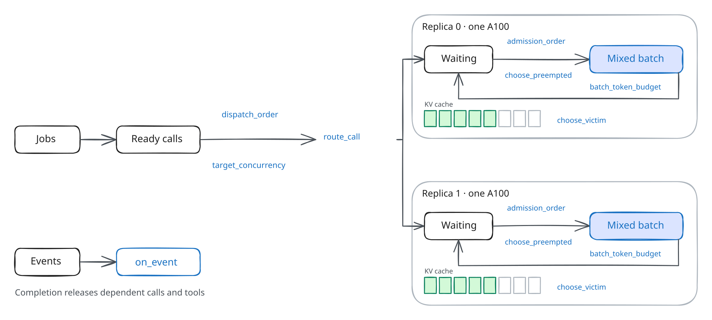
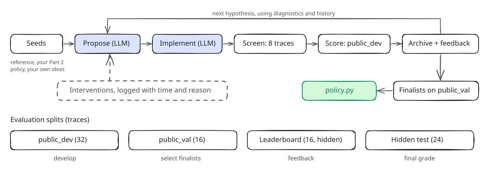

# Assignment 4: Deep Research Agent and Block Management

**Released:** 11/03/2026  
**Due:** 11/16/2026 11:59 PM CT

CS 378: Systems for Generative AI, Fall 2026. Complete this assignment with your registered team of two.

- [Overview](#overview)
- [Setup](#setup)
- [Part 1: Build and analyze a deep research agent](#part-1-build-and-analyze-a-deep-research-agent)
- [Part 2: KV-cache eviction and routing](#part-2-kv-cache-eviction-and-routing)
- [Part 3: Agent-driven policy research](#part-3-agent-driven-policy-research)
- [Testing](#testing)
- [What not to modify](#what-not-to-modify)
- [Submission](#submission)
- [Grading](#grading)
- [Data and licenses](#data-and-licenses)
- [Acknowledgments](#acknowledgments)

## Overview

In Assignment 3, we studied how an LLM serving engine schedules individual requests: chunked prefill, request prioritization, and multi-replica routing. Agentic applications change the problem. One user task issues many dependent LLM and tool calls, some in parallel, and the goal becomes finishing the whole task quickly. These calls also repeat long prompt prefixes, so the engine can reuse cached KV blocks instead of recomputing them, but cached blocks take memory that running calls need.

The assignment has three parts:

- **Part 1** builds a LangGraph research agent and measures its workload: the critical path of each report, how much prompt content repeats and for how long, and what concurrency costs in memory.
- **Part 2** implements KV-cache eviction (LRU, then eviction that keeps prefix trees reusable) and cache-affinity routing across two GPU replicas, and measures where each helps.
- **Part 3** builds an LLM-driven research system that proposes, implements, and evaluates serving policies, and asks how much the agents add beyond what you can design yourself.

The figure below shows how calls flow from the application to the engine; blue labels are the decisions a policy controls.



- **Jobs and ready calls.** A job is one user task (for example, one research report) made of dependent LLM and tool calls. A call is ready when its dependencies finish.
- **Dispatch and routing.** `target_concurrency` caps the calls in flight across the application, `dispatch_order` chooses which ready call goes next, and `route_call` chooses its replica.
- **Engine.** Each replica has its own waiting queue, mixed prefill/decode batches, and KV cache. `admission_order`, `batch_token_budget`, `choose_preempted`, and `choose_victim` decide what is admitted, how large a batch is, which call gives its memory back, and which cached block is overwritten.
- **Events.** The simulator reports what happened (`alloc`, `hit`, `evict`, `complete`, ...) through `on_event`.

### Evaluator configuration

Parts 2 and 3 replay fixed workload traces in a CPU simulator built on [Vidur](https://github.com/microsoft/vidur/tree/25e0082dbbfb206fb0477c3ebbededa7ead78949). A trace fixes every prompt, output length, dependency, and tool delay; a policy decides when and where the work runs.

| Setting | Part 2 | Part 3 |
|---|---|---|
| Model and GPU | Llama-3-8B on one NVIDIA A100 80 GB | Llama-3-8B on each of two A100 80 GB GPUs |
| KV cache | One cache of 16-token blocks | A separate cache on each replica |
| Scheduler | Vidur's vLLM V1 scheduler, mixed prefill and decode | The same scheduler on each replica, after `route_call` |
| Timing | Vidur predictions fitted to [A100 profiling data](https://github.com/microsoft/vidur/tree/25e0082dbbfb206fb0477c3ebbededa7ead78949/data/profiling/compute/a100/meta-llama/Meta-Llama-3-8B) | The same |

- **Job latency** is the time from a job's arrival until its last call or tool finishes, including queueing and tool time. **Speedup** on a trace is the reference policy's mean job latency divided by yours.
- `target_concurrency` returns 1 to 16 calls in flight across all replicas; each replica admits at most 16. `batch_token_budget` returns 512, 1024, 2048 (default), or 4096 tokens.
- Token counts come from the Qwen3 tokenizer and timing from the Llama-3-8B profile. Some traces have prompts up to 32K tokens, beyond Llama-3-8B's native 8K context; the simulator replays them for timing only.
- The simulated engine is separate from the Bedrock models you call in Parts 1 and 3.

## Setup

Use Python 3.11 or newer on Linux or macOS (on Windows, use WSL2). From the repository root, run once:

```bash
python3 -m venv .venv
source .venv/bin/activate
python -m pip install -e '.[agent,notebook,dev]'
python -m ipykernel install --user --name cs378-assignment4 --display-name "CS 378 Assignment 4"
```

Check the simulator with the supplied FIFO policy; the output should end with `Status: VALID`:

```bash
python -m agentkv.score --policy policies/fifo.py --split data/traces/public_dev/dev-W3-0.json
```

Activate `.venv` in every new terminal, then open a notebook and select the **CS 378 Assignment 4** kernel:

```bash
source .venv/bin/activate
jupyter lab notebooks/part1_deep_research.ipynb
```

Scoring runs traces in parallel worker processes (all but one CPU, at most 12; set `AGENTKV_WORKERS` to change it). Call `score()` from a notebook, or from a saved script under `if __name__ == "__main__":`.

### Model access

| Variable | Used by | Value |
|---|---|---|
| `AWS_REGION` and AWS credentials (or `AWS_PROFILE`) | Bedrock calls in Parts 1 and 3 | Course AWS account |
| `AGENTKV_BEDROCK_MODEL` | The Part 1 agent (`--backend bedrock`) | Smaller course model id |
| `AGENTKV_RESEARCH_MODEL` | `examples/research_system.py` | Frontier model id for Part 3 |
| `EXA_API_KEY` (optional) | Optional web search in Part 1 | Exa key, or another provider's |

The values are on the course page, with your team's token budget. Part 1 can run entirely on the offline `FakeLLM`; Part 3 needs Bedrock (`--offline` in `examples/research_system.py` only checks plumbing). Contact staff if Bedrock access is not working by the end of the first week.

### Files you edit

| Path | Part | Purpose |
|---|---|---|
| `research_app/concurrency.py` | 1 | Concurrency cap shared by all reports |
| `research_app/agent.py` | 1 | Research graph nodes and routing |
| `research_app/analysis.py` | 1 | Critical path, prefix reuse, and KV footprint of a run |
| `policies/reference.py` | 2 | LRU eviction; the reference for every Part 3 speedup |
| `policies/prefix_policy.py` | 2 | Prefix-aware eviction and cache-affinity routing |
| `research/` | 3 | Your research system, evaluator, prompts, and configuration (create it) |
| `candidates/` | 2, 3 | Policy experiments and every campaign candidate (create it) |
| `runs/` | 1, 3 | Agent runs and campaign logs |

### Time and weight

| Part | Deliverable | Estimated time | Weight |
|---|---|---|---|
| 1 | Agent, analysis functions, three runs, answers to Q1–Q4 | 10–12 h | 20% |
| 2 | Two policy files, sweeps, answers to Q1–Q3 | 7–8 h | 20% |
| 3 | Research system, campaigns, selected policy, answers to Q1–Q6 | 15–18 h | 60% |

## Part 1: Build and analyze a deep research agent

**Notebook:** [part1_deep_research.ipynb](notebooks/part1_deep_research.ipynb) · **Specification:** [Part 1 handout](docs/part1_handout.md)

The agent splits a question into two to four subtopics, researches them in parallel (search, fetch, extract evidence), runs one follow-up branch if a subtopic has no evidence, writes a cited report, and repairs it once if the citation check fails.


1. Implement the concurrency cap (`research_app/concurrency.py`) and the graph (`research_app/agent.py`).
2. Run the 16 public questions three times: C = 2, C = 8, and C = 8 with 20% of tool attempts failing.
3. Implement `critical_path`, `shared_prefix_share`, `reuse_gaps`, and `kv_footprint` in `research_app/analysis.py`, and replay your own trace on a simulated GPU at several caps and KV-cache sizes.
4. Answer Q1–Q4 on the critical path, prefix reuse and retention, concurrency versus memory, and failures.

An optional section runs the same agent against live web search (Exa, Tavily, Perplexity, or OpenAI). Your Part 1 code affects only your Part 1 grade; Parts 2 and 3 use fixed staff traces.

## Part 2: KV-cache eviction and routing

**Notebook:** [part2_lru_policy.ipynb](notebooks/part2_lru_policy.ipynb) · **Specification:** [Part 2 handout](docs/part2_handout.md)

1. **LRU** (`policies/reference.py`): evict the least recently used cached block, where allocations and hits count as uses and releases do not. Your completed file is the starting policy for Part 3; official speedups are measured against a fixed staff copy of it.
2. **Prefix-aware eviction** (`policies/prefix_policy.py`): evict the least recently used block that is a leaf of its replica's prefix tree, tracking the tree from events.
3. **Cache-affinity routing** (same file): route a call to the replica holding the longest prefix of its prompt, unless that replica is more than `slack` calls busier than the least loaded one.

The notebook sweeps concurrency caps on one and two replicas, compares eviction rules, and sweeps the routing slack; Q1–Q3 ask you to explain the results.

## Part 3: Agent-driven policy research

**Notebook:** [part3_policy_research.ipynb](notebooks/part3_policy_research.ipynb) · **Specification:** [Part 3 handout](docs/part3_handout.md)

Build a research system in `research/` in which LLM agents propose policy changes, implement them, evaluate them in the simulator, and decide what to try next. `examples/research_system.py` is a minimal sequential loop to start from or compare against; you may also adapt a framework such as OpenEvolve, ShinkaEvolve, or CORAL.



- **Seeds and hints are allowed.** A campaign may start from the reference, your Part 2 policy, or any policy you write, and your prompts may contain your own ideas. Declare the seeds and prompts in the campaign configuration, and keep every seed in `candidates/`.
- **The submitted policy must be selected by an unattended campaign** from its candidates, which include its seeds. Log every human action that stops, restarts, or changes a campaign.
- **Measure the agents' contribution.** Q2 compares your best seed alone, a campaign started from the reference, and a campaign started from your seed, with the same model and token budget.

Policies run in a sandbox: they may use past events, the current `View`, and known prompt lengths, but not future arrivals, output lengths, tool durations, trace files, or workload labels. They have no network, file, subprocess, thread, LLM, or wall-clock access, each hook call has 50 ms of CPU time, and policy state must pickle to at most 4 MiB. Invalid ids, evicting an active block, a cap outside 1–16, a malformed admission order, an exception, a timeout, or a stall fails the evaluation.

```bash
python -m agentkv.score --policy candidates/c01.py --split screen        # one dev trace per family
python -m agentkv.score --policy candidates/c01.py --split public_dev --json out.json
```

### Performance metric

```text
L(P, i)  = mean job latency of policy P on trace i
S_f      = geometric mean over traces in family f of L(reference, i) / L(P, i)
S        = geometric mean of S_f over the eight families
g        = 1 - 1/S
g_eff    = g - sum over families of max(0, 0.90 - S_f)
points   = clip(10 + 20 × g_eff / 0.09, 0, 30)
```

Performance (item 3.1) is worth 30% of the grade. A valid policy that matches the reference earns 10%; the full 30% needs `S ≥ 1.099` (a 9% latency reduction) with every family at or above 0.90. A family below 0.90 costs credit in proportion to its shortfall. Invalid or incomplete evaluations earn 0.

| Split | Traces | Use |
|---|---|---|
| `screen` | 8 (from `public_dev`) | Quick checks |
| `public_dev` | 32 | Development, full diagnostics |
| `public_val` | 16 | Selecting finalists |
| Leaderboard | 16 (hidden) | Gradescope feedback |
| Hidden test | 24 (hidden) | Final performance grade |

### Research report

Answer Q1–Q6 in the [Part 3 handout](docs/part3_handout.md#research-report): system design, the agents' contribution and an ablation, autonomy, cost, the selected policy's behavior, and its limitations. Cite run ids and candidate hashes so that claims can be checked against your logs.

## Testing

```bash
source .venv/bin/activate
pytest                                   # the public suite
pytest tests/test_part1_concurrency.py   # one module
pytest -x                                # stop at the first failure
```

Unfinished `[Part 1] TODO` and `[Part 2] TODO` functions raise `NotImplementedError`; with all of them complete, the whole suite passes.

## What not to modify

Keep your changes to the files listed in [Files you edit](#files-you-edit). Do not change the rest of `research_app/`, `agentkv/`, `tests/`, or `data/`. Policies influence execution only through the hooks in `agentkv/policy.py`.

## Submission

### Gradescope: Part 3 leaderboard

Upload these files at the top level (directly or in a flat ZIP):

```text
policy.py         the policy your campaign selected
params.json       optional parameters for policy.py
submission.json   metadata (below)
```

```json
{
  "policy": "policy.py",
  "params": null,
  "candidate_hash": "<SHA-256 of policy.py>",
  "python": "3.12",
  "imports": []
}
```

Use `r.policy_sha256` or `shasum -a 256 policy.py` for the hash, set `params` to `"params.json"` if you use one, and list any imports outside the standard library. Use your registered team name as your leaderboard name. Gradescope scores the policy on the 16 leaderboard traces and shows overall and per-family speedups; your private feedback also shows projected performance points. The reference, FIFO, LRU at cap 4 ("Weak"), and a staff cache-aware policy ("Strong") appear as benchmark rows. The leaderboard is feedback only; the hidden test set determines the grade.

### Canvas: code, runs, and report

Submit one archive per team named `assignment4_<team name>.zip`:

```text
research_app/agent.py, research_app/concurrency.py, research_app/analysis.py
policies/reference.py, policies/prefix_policy.py
policy.py, submission.json, params.json (if used)
runs/c2/, runs/c8/, runs/c8-faults/     Part 1 runs
research/                               your research system, evaluator, prompts, and configuration
candidates/                             every seed and campaign candidate, including failures
runs/<campaign>/                        campaign logs, token receipts, and the intervention log
assignment4_report.pdf
```

`assignment4_report.pdf` contains your team name, both members' names and EIDs, the `pytest` summary, and the answers to Part 1 Q1–Q4, Part 2 Q1–Q3, and Part 3 Q1–Q6 in order, each below its question, with the requested plots and tables. Include Bedrock token receipts (per-call input and output tokens, team total) and the model versions used. There is no page limit.

Both team members must be able to explain all submitted code and analysis if asked by staff. Late submissions lose 10% of the assignment's points per day, including weekends, unless arranged in advance with the instructor.

## Grading

Total: 100% (+10% extra credit)

**Part 1 — Deep research agent and workload analysis: 20%**

- 1.1 Concurrency cap (correctness): 3%
- 1.2 Research graph (correctness): 7%
- 1.3 Workload analysis functions (correctness): 4%
- 1.4 Runs and answers to Q1–Q4: 6%

**Part 2 — KV-cache eviction and routing: 20%**

- 2.1 LRU eviction (correctness): 5%
- 2.2 Prefix-aware eviction (correctness): 4%
- 2.3 Cache-affinity routing (correctness): 3%
- 2.4 Sweeps and answers to Q1–Q3: 8%

**Part 3 — Agent-driven policy research: 60%**

- 3.1 Policy performance on the hidden test set: 30%
- 3.2 Research system and autonomy (Q1, Q3): 10%
- 3.3 Agents' contribution and cost (Q2, Q4): 10%
- 3.4 Policy behavior and limitations (Q5, Q6): 10%

**Extra credit: up to +10%**

- Hidden-test speedup in the top 3% of teams: +5%
- An exceptional research system or report, at staff discretion: +5%

Correctness items are graded by staff tests that check the same contracts as the public tests on different inputs.

## Data and licenses

| Data | Source | License |
|---|---|---|
| Part 1 corpus | English Wikipedia, 48 articles, 2 pinned revisions each | CC BY-SA 4.0 |
| W1 long-context chat | kvcache-ai/Mooncake conversation trace (FAST 2025): token counts and prefix hashes, with placeholder text | Apache-2.0 |
| W2 coding agent | sammshen/lmcache-agentic-traces (SWE-bench sessions) | CC BY 4.0 |
| W3 document QA | bigai-nlco/LooGLE short-dependency QA (ACL 2024) | CC BY-SA 4.0 |
| W4 customer-service agents | sierra-research/tau2-bench published conversations | MIT |
| W5 reasoning chat | alibaba-edu/qwen-bailian-usagetraces-anon thinking trace: token counts and prefix hashes, with placeholder text | Apache-2.0 |
| Bursty arrivals | kvcache-ai/Mooncake tool-agent trace (timestamps only) | Apache-2.0 |
| Tokenizer | Qwen/Qwen3-0.6B tokenizer (shared by all Qwen3 sizes) | Apache-2.0 |
| Simulator | microsoft/vidur @ 25e0082dbbfb | MIT |

Each trace's `generation` field records the generator, seed, and settings that produced it, and the exact source datasets and revisions.

## Acknowledgments

The evaluator uses Vidur's vLLM V1 scheduler and cache manager, with adapters for the assignment's policy hooks and job dependencies. The Part 1 agent is adapted from LangChain's *Deep Research from Scratch* (MIT). The workloads come from the public traces and datasets above; we thank their authors for releasing them.
