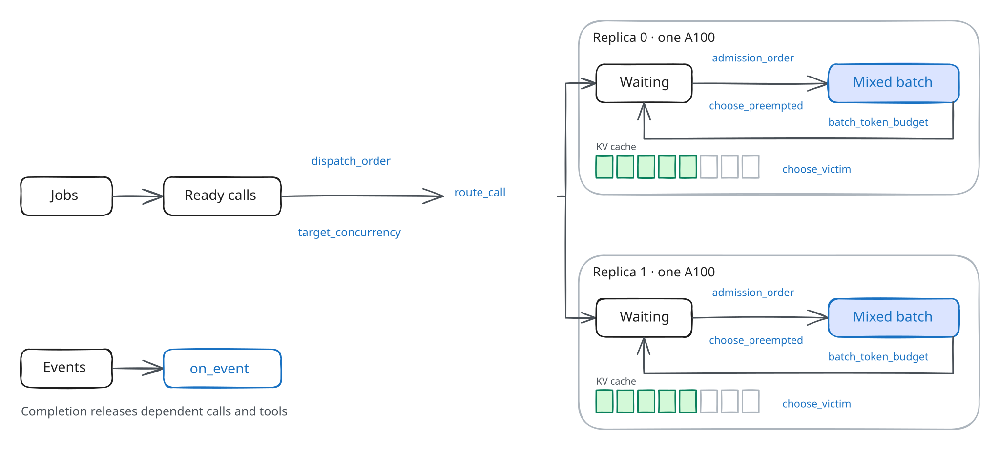
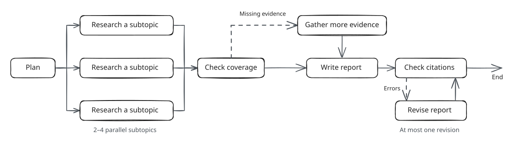
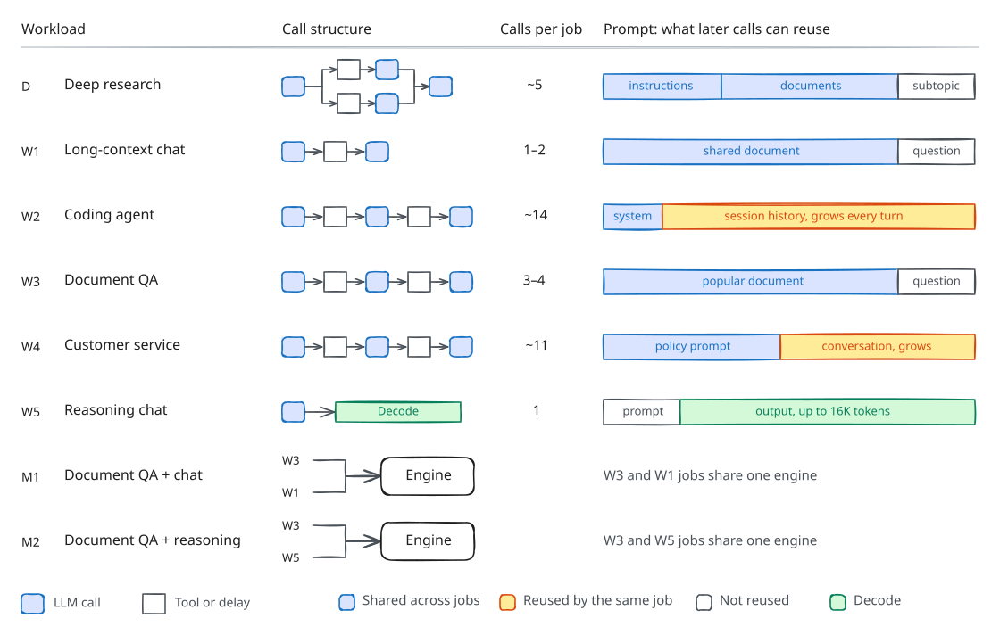
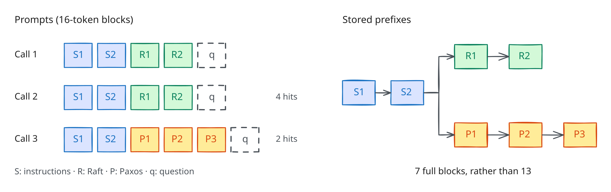
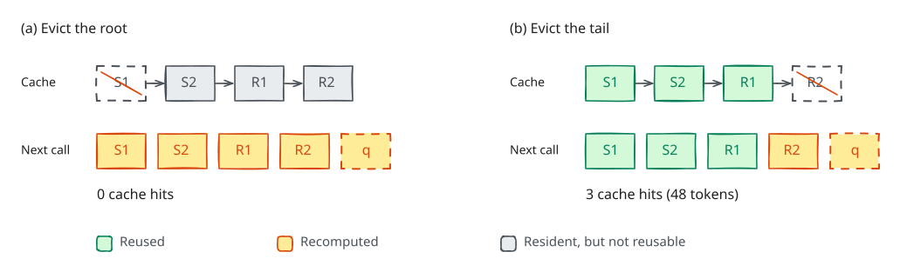
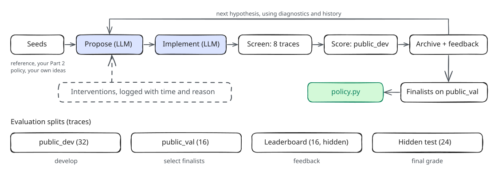

# Assignment 4: Deep Research Agent and Block Management

**Released:** 11/03/2026  
**Due:** 11/16/2026 11:59 PM CT

CS 378: Systems for Generative AI, Fall 2026. Complete this assignment with your registered team of two.

- [Overview](#overview)
- [Setup](#setup)
- [Part 1: Run and analyze a deep research agent](#part-1-run-and-analyze-a-deep-research-agent)
- [Part 2: KV-cache eviction and routing](#part-2-kv-cache-eviction-and-routing)
- [Part 3: Agent-driven policy research](#part-3-agent-driven-policy-research)
- [Submission](#submission)
- [Grading](#grading)
- [Acknowledgments](#acknowledgments)


## Overview

Previously in [Assignment 3](../assignment3/README.md), we studied how an LLM serving engine schedules requests efficiently. We implemented techniques such as chunked prefill, request prioritization, and multi-replica routing, and measured their effects on latency and throughput. Those techniques focused on scheduling **individual** LLM requests.

**Agentic applications introduce new challenges.** A single user task typically involves multiple LLM calls and tool invocations, with some running in parallel and others waiting on earlier results. For example, a deep research agent may first plan a task, investigate several subtopics concurrently, and then synthesize its findings. In this setting, optimizing individual calls in isolation is no longer enough—the goal is to minimize end-to-end completion time for the entire user task.

At the same time, agentic workflows create new opportunities for optimization. Related LLM calls often share long prompt prefixes, allowing the inference engine to reuse previously computed KV-cache blocks instead of recomputing prefill from scratch. Retaining cached blocks, however, consumes GPU memory that active requests also need. Serving agentic workloads efficiently therefore requires jointly managing call dependencies, concurrency, request scheduling, replica routing, and KV-cache eviction.

In this assignment, you will study these system tradeoffs first-hand and then explore an automated approach to designing serving policies. After analyzing the research agent and implementing KV-cache eviction and routing policies, you will build an LLM-driven agentic research system that iteratively proposes, implements, and evaluates serving policies. Along the way, you will evaluate both the policies discovered by your agents and the reliability, cost, and generalizability of the automated research process itself.

Parts 2 and 3 run on a CPU simulator built on [Vidur](https://github.com/microsoft/vidur/tree/25e0082dbbfb206fb0477c3ebbededa7ead78949) that models Llama-3-8B on one or two A100 GPUs, each with its own request queue and KV cache. The figure below shows how calls move from the application into the inference engine, with blue labels marking the hooks your policy can implement:



- **Concurrency and dispatch:** A **job** (such as generating a research report) consists of dependent LLM and tool calls. Once a call's dependencies finish, it enters **ready calls**. Your policy controls how many calls can be in flight (`target_concurrency`), which ready call is dispatched next (`dispatch_order`), and which GPU replica receives it (`route_call`).
- **Replica scheduling and KV-cache management:** Each replica maintains its own waiting queue, mixed prefill/decode batch, and KV cache. Your policy controls admission order (`admission_order`), batch token budget (`batch_token_budget`), preemption under memory pressure (`choose_preempted`), and cached block eviction (`choose_victim`), while observing system events through `on_event`.


## Setup

Use Python 3.11 or newer on Linux or macOS. From the repository root:

```bash
python3 -m venv .venv
source .venv/bin/activate
python -m pip install -e '.[agent,notebook,dev]'
python -m ipykernel install --user --name cs378-assignment4 --display-name "CS 378 Assignment 4"
```

Verify the simulator installation:

```bash
python -m agentkv.score --policy policies/fifo.py --split data/traces/public_dev/dev-W3-0.json

# Should print `Status: VALID`
```

Launch Jupyter (`jupyter lab`), open the notebooks, and select the **CS 378 Assignment 4** kernel. Run `pytest` to execute the public test suite. All public tests should pass once you complete the Part 1 and Part 2 `TODO`s.

### Model access

Part 1 runs offline and needs no key. Part 3 calls models on Amazon Bedrock through the course LLM proxy. Each student gets a key; your team's keys share a $50 budget, and requests are refused once it is spent. Save your key:

```bash
(umask 077; echo 'sk-...' > ~/.agentkv_llm_key)
```

Never put your key in a notebook or a committed file.

| Model | Id | $ per 1M input / output tokens |
|---|---|---|
| Claude Haiku 5.5 | `global.anthropic.claude-haiku-5-5` | 0.10 / 0.50 |
| Claude Sonnet 5.5 | `global.anthropic.claude-sonnet-5-5` | 2 / 10 |
| Claude Opus 5.5 | `global.anthropic.claude-opus-5-5` | 4 / 20 |
| GPT-6.1 Terra | `global.openai.gpt-6.1-terra` | 1 / 5 |
| GPT-6.1 Sol | `global.openai.gpt-6.1-sol` | 2 / 10 |
| GPT-6 Luna | `global.openai.gpt-6-luna` | 0.10 / 0.50 |

`examples/research_system.py` uses Sonnet 5.5; set `AGENTKV_RESEARCH_MODEL` to another id to change it. Frameworks that take an OpenAI-compatible endpoint use base URL `https://llm.utcs378-infra.duckdns.org/v1` and your key as the API key, for example `OPENAI_API_KEY=$(cat ~/.agentkv_llm_key) python ...`.

Check your usage:

```bash
curl -s https://llm.utcs378-infra.duckdns.org/key/info -H "Authorization: Bearer $(cat ~/.agentkv_llm_key)" | python3 -c 'import json,sys; print("Usage: $%.2f / $50" % json.load(sys.stdin)["info"]["spend"])'
```

## Part 1: Run and analyze a deep research agent

[Notebook](notebooks/part1_deep_research.ipynb)

In this part, you will run a LangGraph-based deep research agent on 16 questions and characterize the workload it generates for an inference engine. Specifically, you will measure:

- **Critical-path latency:** which LLM calls and tool invocations actually determine each report's end-to-end completion time.
- **Prefix reuse:** how much prompt content is repeated across calls, and how long cached KV blocks must stay in memory to be reused.
- **Concurrency vs. memory:** how bounding concurrent LLM calls trades queueing delay against peak KV-cache memory footprint.


### The agent



For each question, the agent gathers evidence from a local corpus and synthesizes a cited report in five stages:

1. **Plan (**`plan`**):** One LLM call breaks the question into two to four subtopics and proposes a search query for each.
2. **Research subtopics in parallel (**`research_subtopic`**):** Each subtopic runs as a parallel branch. A branch searches the local corpus, fetches up to three matching documents concurrently, and makes one LLM call (`extract`) to pull relevant verbatim quotes. These quotes and their source metadata form the evidence pool.
3. **Check coverage (**`coverage` **/** `followup`**):** Once all branches finish, the agent checks whether every subtopic gathered at least one piece of evidence. If any subtopic has no evidence, the agent re-researches the first missing subtopic once with a broader query before moving on.
4. **Synthesize (**`synthesize`**):** One LLM call combines the collected evidence into a structured report where every claim cites supporting evidence IDs.
5. **Validate and repair (**`validate` **/** `repair`**):** A checker verifies citation integrity, confirming that every claim cites valid evidence IDs and that every quoted span appears in its source document. If validation fails, the agent makes at most one `repair` LLM call followed by a final check.

To bound cost on misbehaving runs, the tracing client caps each report at 8 LLM calls, 5 searches, and 15 document fetches, with at most 3 attempts per operation.

#### LangGraph 101

The agent workflow in `research_app/agent.py` is built using five core [LangGraph](https://langchain-ai.github.io/langgraph/) primitives:

- **State:** A shared dictionary (`ReportState` in `research_app/agent.py`) that flows through the graph. Each node receives the current `state` (and, for `async` nodes that call tools or the LLM, `config`) and returns a `dict` containing only the keys it updates.
- **Edges:** `g.add_edge("synthesize", "validate")` unconditionally runs `validate` after `synthesize`.
- **Conditional edges:** `g.add_conditional_edges("coverage", route_coverage, ["followup", "synthesize"])` calls `route_coverage(state)` to decide which node runs next.
- **Fan-out (**`Send`**):** A routing function can return a list of `Send("research_subtopic", payload)` objects to launch multiple parallel instances of `research_subtopic`. Because `branches` is annotated with `Annotated[list[BranchResult], operator.add]`, each branch returns a one-element list and LangGraph automatically concatenates the results.
- **Join:** `g.add_edge("research_subtopic", "coverage")` waits for all parallel `research_subtopic` branches to complete before running `coverage` once.


### 1.1 Concurrency limit

When all 16 reports run concurrently, they share a single global concurrency limit `C` on in-flight LLM calls. The tracing client acquires a slot before each LLM call (holding that slot across any retries) and does not acquire slots for search or fetch tool calls.

This limit is enforced by `ConcurrencyLimiter` in `research_app/concurrency.py`, which wraps an `asyncio.Condition` (`self._cond`) and tracks the limit (`self._limit`, restricted to 1–8) and the number of active calls (`self._in_flight`).

Complete its three methods:

- **`acquire()`:** Wait until `_in_flight < _limit`, then increment `_in_flight` while still holding the condition lock so concurrent callers cannot claim the same slot. If a waiting task is cancelled before acquiring a slot, `_in_flight` must remain unchanged.
- **`release()`:** Decrement `_in_flight` under the condition lock and notify waiting tasks. If `release()` is called when `_in_flight == 0`, raise a `RuntimeError`.
- **`set_limit(limit)`:** Update `_limit` (the 1–8 range check is already provided) under the condition lock and wake any waiting tasks so they can re-check the limit if it increased. If the limit is lowered below the current `_in_flight`, do not cancel or interrupt running calls—let them finish naturally and allow waiting calls to proceed only once `_in_flight` drops below the new `_limit`.

Test your implementation:

```bash
pytest tests/test_part1_concurrency.py
```

### 1.2 Research graph

The agent workflow in `research_app/agent.py` is already implemented for you—you do not need to modify it, though we will ask you about how it works during the grading interview.

1. Read `research_app/agent.py` alongside the workflow diagram above to trace how parallel subtopic branches fan out and join, and how the follow-up and citation-repair paths work.
2. In Section 3 of `notebooks/part1_deep_research.ipynb`, run a single report and inspect its generated markdown and citations.
3. Run the workflow test suite to verify that the agent, citation checker, and trace exporter pass with your `ConcurrencyLimiter`:

```bash
pytest tests/test_part1_agent.py tests/test_part1_citations.py tests/test_part1_llm.py tests/test_part1_trace_export.py
```


### 1.3 Workload analysis

Next, implement the four workload analysis functions in `research_app/analysis.py`. You will use these functions in Section 5 of the notebook to plot and analyze the traces recorded in Section 4.

A recorded trace is loaded via `run = load_run("runs/c2")`. Each recorded operation is represented by an `Op` object containing its dependencies (`deps`), timestamps (`start`, `end`, `slot_requested`, `slot_acquired`), token counts (`prompt_tokens`, `output_tokens`), and 256-token prefix `block_hashes`.

- **`critical_path(run, report) -> list[Step]`**  
  Finds the chain of operations that determined when `report` finished, returned in chronological order from first to last.
  - **Backward walk:** Start at the operation in `report` with the latest `end` time (breaking ties by larger `op_id`). Repeatedly step to whichever of its dependencies in `run.ops` finished last (using the same tie-breaker), ignoring any dependency IDs not present in `run.ops`, until you reach an operation with no dependencies in the run. Raise `KeyError` if the report has no operations.
  - **Latency breakdown:** Convert each operation on the path into a `Step(op_id, kind, stage, gap, wait, service)`, where:
    - `gap` is the time between the blocking dependency's `end` (or the report's arrival time `run.arrivals[report]` for the first step) and this operation's `start`;
    - `wait` is the time spent waiting for an LLM concurrency slot (`op.slot_wait`, which is `0.0` for tools);
    - `service` is the remaining duration of the operation (`op.end - op.start - wait`), including any retries.  
    Across the returned steps, the sum of `gap + wait + service` equals the report's end-to-end latency.
- **`prefix_hit_rate(calls, block_size=256) -> float`**  
  Computes the fraction of all prompt tokens across `calls` (passed in start order via `run.llm_calls()`) that would hit in an unbounded prefix cache.
  - A full 256-token block in a call's `block_hashes` counts as a cache hit (contributing `block_size` shared tokens) if its hash appeared in an earlier call in `calls`.
  - Check a call's blocks against the history of previously seen hashes *before* adding that call's hashes to the history.
  - Divide the total shared tokens by the sum of `prompt_tokens` across all calls (which includes trailing partial blocks). Return `0.0` if total `prompt_tokens` is zero.
- **`reuse_intervals(calls) -> list[Reuse]`**  
  Measures, for each reuse of a prefix block, how long that block would have sat unreferenced between the end of the last earlier call holding it and the start of the reusing call (or `0.0` if an earlier holder is still running).
  - Process `calls` in start order, treating each call as holding its blocks from `call.start` to `call.end`.
  - Whenever a block hash in `call.block_hashes` was already seen in at least one earlier call, emit one `Reuse(block, stage, source, interval)` (at most once per distinct block in the current call):
    - `stage` is the current (reusing) call's stage;
    - `source` is the stage of the earlier holder with the latest `end` time;
    - `interval` is `call.start` minus that latest `end` time, or `0.0` if an earlier holder is still running at `call.start`.
- **`kv_footprint(calls, bytes_per_token=..., block_size=256) -> list[Footprint]`**  
  Computes the time series of KV-cache memory held by active LLM calls, comparing private storage against shared-prefix storage.
  - An LLM call occupies KV memory during `[slot_acquired, end)`, holding `prompt_tokens + output_tokens` tokens (at 128 KiB per token by default for Llama-3-8B in bf16).
  - Evaluate the footprint at every distinct `slot_acquired` and `end` timestamp across `calls` in ascending order. At timestamp `t`, a call is active if `slot_acquired <= t < end`.
  - At each timestamp `t`, record a `Footprint(t, calls, private, shared)`:
    - `calls`: the number of active LLM calls holding a slot at time `t`.
    - `private`: total KV bytes if every active call stores all of its `prompt_tokens + output_tokens` independently.
    - `shared`: total KV bytes if identical full prefix blocks (`block_hashes`) are stored only once across all active calls, while each call's remaining tokens (its trailing partial prompt block plus `output_tokens`) are stored separately.

Test your analysis functions:

```bash
pytest tests/test_part1_analysis.py
```


### 1.4 Runs and questions

Generate three workload traces over the 16 public questions (with one report arriving every 2 seconds):

```bash
python -m research_app.run --cap 2 --replay --out runs/c2
python -m research_app.run --cap 8 --replay --out runs/c8
python -m research_app.run --cap 8 --failure-rate 0.2 --replay --out runs/c8-faults
```

- **LLM backend:** By default, these commands use the deterministic offline `FakeLLM`, which is sufficient for Part 1. To use Bedrock instead, save your key as in [Model access](#model-access), set `AGENTKV_BEDROCK_MODEL`, and pass `--backend bedrock`. Use the same backend for all three runs and state which one you used in your report.
- **Fault injection:** `--failure-rate 0.2` causes each search or fetch tool attempt to fail transiently with 20% probability.
- **Outputs:** Every run must finish with `16/16 valid`. Each run directory saves `trace.jsonl`, `reports.json`, `summary.json`, and `replay.json` (a simulator-compatible trace of the run). Because Bedrock does not expose internal KV-cache state, `block_hashes` are always computed locally over 256-token prompt blocks to measure potential prefix reuse.

In Section 5 of `notebooks/part1_deep_research.ipynb`, run the cells to plot your workload analysis and replay `runs/c8/replay.json` in the Vidur simulator on one A100 replica with `policies/fifo.py` across concurrency limits `C` in `(1, 2, 4, 8, 16)` and KV capacities of `(12,288, 16,384, 49,152, 393,216)` tokens (plus a finer sweep of `C` in 4–8 at 16,384 tokens). Use your plots and numbers to answer **Q1–Q4** in `assignment4_report.pdf`.

**Q1. Critical path.**

- For one report from `runs/c2`, include its DAG plot showing the critical path and report the time (in seconds) spent in `gap`, `wait` (slot wait), LLM `service`, and tool `service` along that path.
- Report the same four-way breakdown averaged across all 16 reports at C = 2 and at C = 8. Which component dominates at each concurrency limit? Explain any shift in the bottleneck.
- At C = 8, each report fans out its subtopic branches in parallel (`Send`) and fetches up to three documents per branch in parallel (`asyncio.gather`). Estimate how much the critical path would grow if subtopics ran sequentially, and separately if fetches within a branch ran sequentially. Use the recorded service times, hold other delays fixed, and state your assumptions; this is an estimate, not a prediction of how slot waits would change after rescheduling all reports. Which change to the workflow or output length would save the most time, and by roughly how much? No implementation is needed.

**Q2. Prefix reuse.**

- At C = 8, report `prefix_hit_rate` overall and by stage, and identify what prompt content each stage reuses. Does the overall rate differ at C = 2? Explain why changing concurrency can change reuse timing without changing the prompt content, and discuss any content differences in your runs. Which stage accounts for the most prompt tokens, and how does its hit rate compare with the others?
- At C = 8, for each stage that reuses blocks, report the fraction of reuses with `interval == 0`, the 90th-percentile interval, and the maximum interval. Explain the zero intervals and any long tail in `extract`. Compare the overall fraction of zero intervals at C = 2 and C = 8. Remember that `reuse_intervals` models a call as holding blocks from `start` to `end`, including time spent waiting for a slot; it does not measure actual GPU cache residency.
- Which full 256-token prefix blocks appear in only one call in these recorded runs? Identify what prompt content they contain and explain why retaining them would not help this fixed workload.

**Q3. Concurrency and memory.**

- Complete the comparison table from your C = 2 and C = 8 runs:

  |       | Mean report latency | Makespan | Mean slot wait | Peak concurrent LLM calls | Peak KV, no sharing | Peak KV, prefix sharing |
  | ----- | ------------------- | -------- | -------------- | ------------------------- | ------------------- | ----------------------- |
  | C = 2 |                     |          |                |                           |                     |                         |
  | C = 8 |                     |          |                |                           |                     |                         |

- Plot mean report latency against C for each KV capacity. Identify where increasing concurrency helps, levels off, or hurts, and explain the differences using `preemptions`, `recomputed_tokens`, and `evictions`. Pay particular attention to 12,288 and 16,384 tokens. What do the results imply about choosing a concurrency limit near the KV memory limit?
- On a single 80 GB A100 with 16 GB occupied by model weights, which concurrency limit and KV capacity from the replay sweep would you choose? Justify the choice using latency and memory use. Use the replay's peak resident KV memory (active plus cached blocks) to estimate KV headroom within the remaining 64 GB. Treat this as a capacity estimate, ignore other runtime allocations, and use consistent units. If limited to 16,384 KV tokens (2 GiB, about 2.15 GB), which C in 4–8 would you choose, and why?

**Q4. Failures.**

- Compare `runs/c8-faults` against `runs/c8`: report the number of retried operations, follow-up branches, and repair calls. Check whether the follow-up branches and repair calls lie on their reports' critical paths, and explain this using the graph dependencies. In `runs/c8-faults`, compare the fraction of all tool operations on a critical path with the fraction of retried tool operations on a critical path. Explain any difference.
- Report the median and maximum report latency for both `runs/c8` and `runs/c8-faults`.
- In `TracingClient.llm_call`, an LLM call keeps its slot during retry backoff. Using your C = 2 slot waits, discuss when releasing it would help or hurt mean report latency. The required fault run injects tool failures, so treat LLM retries as a hypothetical case. For a serving engine that retains prefixes between attempts, also discuss possible cache effects under tight memory and state your assumptions about retention. No extra experiment is required.


### Optional: research on the live web

After finishing the required tasks, you can use Section 6 of the notebook to run the research agent against live web search (via Exa, Tavily, Perplexity, or OpenAI) instead of the offline Wikipedia corpus. This section is ungraded.

## Part 2: KV-cache eviction and routing

[Notebook](notebooks/part2_lru_policy.ipynb)

An inference engine can retain a finished call's KV-cache blocks in GPU memory so that later calls sharing the same prompt prefix can skip prefill computation. However, cached blocks consume memory that active calls also need. In this part, you will implement and evaluate three core mechanisms in the simulated serving engine:

1. **LRU eviction (`policies/reference.py`):** The baseline eviction policy that serves as the reference for Part 3.
2. **Prefix-aware eviction (`policies/prefix_policy.py`):** A tree-aware eviction policy that evicts leaves first so shared prefix chains remain usable.
3. **Cache-aware routing (`policies/prefix_policy.py`):** A two-replica router that balances prefix-cache affinity against queue load across GPUs.


### The simulator

Each evaluation trace represents a workload of 16 jobs across one of eight agentic workload families:



- **Jobs and traces:** Each job is a DAG of LLM calls and tool delays with fixed prompts, output lengths, and arrival times. The simulator replays traces on Llama-3-8B across one or two A100 GPUs (*replicas*), using Vidur's vLLM V1 scheduler (which mixes prefill and decode tokens in each batch) and timing predictions derived from A100 profiling data. Each replica maintains its own request queue and KV cache.
- **Latency and speedup:** A job's **latency** is the elapsed time from its arrival until its final LLM call or tool step completes. On a given trace, a policy's **speedup** is the reference policy's mean job latency divided by the policy's mean job latency; `score()` aggregates these speedups across all eight workload families (see [Scoring](#scoring)).


#### Prefix caching and block states

Following vLLM's prefix caching design, KV memory on each replica is partitioned into a pool of 16-token blocks. Each full 16-token block of a prompt is identified by a cumulative `block_hash` computed over its tokens and all preceding tokens in the prompt. At any time, each physical block slot is in one of three states:

- **active:** currently held by at least one running call (`ref_cnt > 0`);
- **cached:** unreferenced (`ref_cnt == 0`), but its contents remain in memory in case a future prompt shares the same prefix;
- **empty:** holds no reusable data.



When a running call needs a new block, the engine uses an empty slot if one is available; otherwise, it calls your policy's `choose_victim` hook to select a cached block to overwrite. Each trace's KV capacity is sized to its active working set so that eviction choices directly affect performance. Crucially, **a resident block can be reused only if every preceding block in the prompt is also resident (active or cached) on that replica.**

### The policy API

A policy is defined as a `Policy` subclass in a single Python file. Two hooks (`target_concurrency` and `choose_victim`) are required; all other hooks default to the reference behavior.


| Hook                                     | Returns                                                                                 | Default                  |
| ---------------------------------------- | --------------------------------------------------------------------------------------- | ------------------------ |
| `on_event(event, state)`                 | nothing; observes every engine event (fields in `agentkv.policy.EVENT_FIELDS`)          | ignore                   |
| `target_concurrency(view, state)`        | maximum calls in flight across all replicas (`1`–`16`)                                  | *required*               |
| `choose_victim(view, candidates, state)` | one block id from `candidates` (cached blocks on `view.replica`, oldest-released first) | *required*               |
| `dispatch_order(view, ready, state)`     | ready call ids to dispatch, in desired order (may return any subset)                    | oldest first             |
| `route_call(view, call, state)`          | target replica id for a dispatched call                                                 | fewest calls in flight   |
| `admission_order(view, waiting, state)`  | `waiting` call ids reordered; the engine admits from the front while blocks fit         | first come, first served |
| `batch_token_budget(view, state)`        | `512`, `1024`, `2048`, or `4096` tokens for the next batch on `view.replica`            | `2048`                   |
| `choose_preempted(view, running, state)` | one running call id to preempt (releasing its blocks) when memory runs out              | `running[-1]`            |


- **`view` (`agentkv.policy.View`):** A read-only snapshot of the engine passed to decision hooks. It exposes:
  - Total and per-replica memory and queue counts (`view.replicas`);
  - Ready calls (`view.ready`) and in-flight calls (`view.calls`), each with its job id, stage, prompt length, and `block_hashes`;
  - Resident prefix blocks (`view.blocks`), each with its `block_hash`, `parent_hash`, `replica`, and `ref_cnt`;
  - Active jobs (`view.jobs`);
  - `view.num_cached_blocks(call, r)`, which counts how many leading full blocks of `call`'s prompt are currently resident on replica `r`.
- **`state` (`agentkv.policy.State`):** A mutable dictionary persisted across hook calls within a single trace (reset between traces). Use `state.rng` as your only source of randomness. Block, call, and job IDs are opaque and vary across traces.
- **Multi-replica state:** A single policy instance and `state` dict are shared across all replicas. Engine-level hooks (`choose_victim`, `admission_order`, `batch_token_budget`, `choose_preempted`) set `view.replica` to identify which replica is requesting a decision.
- **Sandbox limits:** Policies execute in a restricted sandbox with a 50 ms CPU limit per hook call and a 4 MiB serialization limit on `state` plus policy attributes (see [Policy rules](#policy-rules)).

You can score policies from the command line or from Python:

```bash
python -m agentkv.score --policy policies/prefix_policy.py --split public_dev --params '{"balance_threshold": 2}'
python -m agentkv.score --policy policies/reference.py --split public_dev --replicas 1 --params '{"cap": 4}'
```

By default, `score()` simulates **two replicas** (pass `replicas=1` for single-replica experiments), whereas `viz.record` simulates **one replica** (pass `replicas=2` for two-replica timelines). Because `score()` evaluates traces in parallel across CPU cores (up to 12 workers; override with `AGENTKV_WORKERS`), always invoke it from a notebook cell or inside an `if __name__ == "__main__":` guard.

### 2.1 LRU

Complete `__init__`, `on_event`, and `choose_victim` in `policies/reference.py` (`target_concurrency` is already implemented and returns `self.cap`, which defaults to 8):

- **Tracking recency (`on_event`):** Maintain the recency order of resident blocks across events:
  - `alloc` and `hit` events mark `event.block` as the most recently used block.
  - `release` events do *not* count as accesses and must not update recency.
  - `evict` events remove `event.block` from your tracking state.
  - Because multiple events from the same GPU batch can share a timestamp `event.t`, track recency strictly by **event delivery order** rather than by timestamp.
- **Selecting a victim (`choose_victim`):** Return the least recently used block ID among `candidates`. Note that your recency structure may also contain currently active blocks (`ref_cnt > 0`), so only consider block IDs present in `candidates` (and do not rely on `candidates[0]`, which is ordered by release time rather than last access).

Run the LRU unit tests and the reference verification test:

```bash
pytest tests/test_part2_lru.py tests/test_reference_results.py
```

`test_reference_results.py` takes a few minutes and verifies that your `policies/reference.py` reproduces the staff reference's exact job latencies on both public splits. Note that `score()` compares against frozen staff reference latencies (`agentkv/data/vidur_reference.json`), so you can score other policies even before finishing 2.1.

### 2.2 Prefix-aware eviction



When a call runs, it accesses its prompt blocks sequentially from root to tail. Under plain LRU, the root block of a shared prefix appears *least* recently used—and evicting that root immediately makes every descendant block after it unusable.

Complete `__init__`, `on_event`, and `choose_victim` in `policies/prefix_policy.py` to implement leaf-first LRU eviction:

- **Eviction rule (`choose_victim`):** When `self.leaf_first` is `True` (the default), return the least recently used block in `candidates` that is currently a **leaf** of its replica's prefix tree; if no candidate is a leaf, fall back to the least recently used candidate overall. When `self.leaf_first` is `False`, behave identically to plain LRU.
- **Definition of a leaf:** A candidate block is a leaf if no currently resident block on the same replica has a `parent_hash` equal to the candidate's `block_hash`. Once all of a block's resident children on that replica have been evicted, the block itself becomes a leaf.
- **Block IDs vs. prefix hashes:** `event.block` is the residence ID of one physical copy on a replica, whereas `event.block_hash` identifies the prefix content. Critically, a child block's `parent_hash` matches its parent's `block_hash` (not its residence ID `event.block`), and identical prefix blocks cached on different replicas share the same `block_hash` while having distinct residence IDs.
- **Maintaining prefix trees from events (`on_event`):** Build and update the prefix tree structure using `on_event` rather than reading `view.blocks` (the unit tests invoke `choose_victim` with `view=None`):
  - On `alloc`, record the block's `block_hash`, `parent_hash` (`None` for the first block of a prompt), and `replica`, in addition to updating its recency.
  - On `hit`, update the block's recency.
  - On `evict` (which carries only `event.block`), remove the block from both your recency state and its replica's prefix tree.

Leave `route_call` for Section 2.3 (for the 2.2 experiments, pass `balance_threshold=-1` so the supplied fallback routes to the least-loaded replica). Run the eviction tests:

```bash
pytest tests/test_part2_prefix.py -k "not route"
```

### 2.3 Cache-aware routing

With two GPU replicas, a prefix cached on replica 0 does not benefit a call dispatched to replica 1. Following SGLang's cache-aware router, implement `PrefixPolicy.route_call` in `policies/prefix_policy.py`:

- **Eligible replicas:** Find the minimum `in_flight` count across all replicas (`view.replicas[r].in_flight`). A replica `r` is eligible if its `in_flight` count is at most `self.balance_threshold` above that minimum.
- **Replica selection:** Among eligible replicas, choose the replica with the largest number of cached prompt blocks for `call` (`view.num_cached_blocks(call, r)`), breaking ties by lower `in_flight` count and then by lower replica ID `r`.
- **Fallback (`balance_threshold == -1`):** When `balance_threshold == -1` (already handled by the supplied `if` check), route to the least-loaded replica just like the reference policy.

With `leaf_first=False` and `balance_threshold=-1`, `PrefixPolicy` makes the exact same decisions as `ReferencePolicy`. Run the full Part 2 prefix test suite:

```bash
pytest tests/test_part2_prefix.py
```


### 2.4 Experiments and questions

In `notebooks/part2_lru_policy.ipynb`, run the experiments and answer **Q1–Q3** in `assignment4_report.pdf`:

1. **Concurrency sweep (Section 4):** Sweep `cap` over `(2, 4, 8, 16)` on `public_dev` using `policies/reference.py` on both one replica (`replicas=1`) and two replicas (`replicas=2`).
2. **Eviction comparison (Section 5):** Compare `policies/fifo.py` against `policies/reference.py` on one replica, and compare `policies/prefix_policy.py` with `leaf_first=False` vs. `leaf_first=True` (keeping `balance_threshold=-1`) on one and two replicas.
3. **Routing sweep (Section 6):** With prefix-aware eviction enabled (`leaf_first=True`), sweep `balance_threshold` over `(-1, 0, 1, 2, 4, 16)` on two replicas, and inspect the two-replica timelines on the customer-service trace `dev-W4-0` at thresholds `1` and `16`.

If you want to test custom policy variants, save them as copies under `candidates/` rather than modifying `policies/reference.py` or `policies/prefix_policy.py`.

**Q1. Concurrency.**

- Looking at the one-replica and two-replica concurrency grids, which workload families prefer a low concurrency limit on one replica? Explain why in terms of their memory per call, prefix reuse, and job DAG structure.
- For which families does the best tested concurrency limit change when moving from one replica to two? Explain the changes, and note any families whose best limit stays the same.
- Identify one workload family whose ideal concurrency limit likely changes *within* a single trace, and explain which trace feature causes this.

**Q2. Eviction.**

- Present a single table showing overall speedup `S` and per-family speedups (relative to LRU) for: (a) FIFO on one replica, (b) prefix-aware eviction on one replica, and (c) prefix-aware eviction on two replicas.
- Which workload families benefit most from prefix-aware eviction, and what about their prompts explains the result? Compare the relative gains on one and two replicas. Explain the differences, including any cases where two replicas do not reduce the gain.
- Describe a realistic or hypothetical workload in which evicting leaf blocks first performs *worse* than plain LRU.

**Q3. Routing.**

- Include the `balance_threshold` speedup grid from Section 6 and state which threshold achieves the highest overall `S`.
- Which workload families regress at `balance_threshold = 16`, and what in the two `dev-W4-0` timelines (`balance_threshold = 1` vs. `16`) explains why?
- Propose a change to `route_call` that reduces the observed W4 regression using only the current view and past events. What load-versus-affinity tradeoff does it make? Could it guarantee no regression on unseen W4-like workloads without falling back to least-loaded routing? Explain; no implementation is required.


### Optional: job-first dispatch

Section 7 of `notebooks/part2_lru_policy.ipynb` explores `dispatch_order` (prioritizing ready calls from older jobs). This section is ungraded and requires no submission.

## Part 3: Agent-driven policy research

[Notebook](notebooks/part3_policy_research.ipynb)

In this final part, you will build an automated research system in which LLM agents iteratively propose, implement, and evaluate serving policies for the two-replica simulator. Your system will select your final `policy.py` submission, and you will analyze what the agents discovered beyond your hand-written seed policies.



### What to build

All policies in Part 3 are evaluated on **two replicas** (each with its own queue and KV cache) and scored relative to `policies/reference.py` (LRU eviction at `cap = 8` with least-loaded routing; see [The policy API](#the-policy-api)). Create a new `research/` directory for your Part 3 code (`examples/` provides reference templates to copy or adapt):

1. **Build your research loop in `research/`:**  
   `examples/research_system.py` provides a minimal greedy baseline: it prompts an LLM with the policy API and current best policy, extracts one candidate Python file, evaluates it, and keeps it if it improves the objective. You may extend this script or adapt an existing evolutionary/agentic code-search framework (such as OpenEvolve, ShinkaEvolve, or CORAL—if you use one, record its git commit and license in `campaign.json`).
2. **Define your evaluator in `research/evaluator.py`:**  
   Copy `examples/evaluator.py` to `research/evaluator.py` and customize:
   - the scalar `objective` your search maximizes (must be `None` for invalid candidates, and a finite number for valid ones); and
   - the diagnostic feedback returned to your agents.  
   The dictionary returned by `evaluate()` must preserve `valid`, `violations`, `speedup`, and `by_family`, in addition to `objective`.

By default, `examples/research_system.py` starts from your completed `policies/reference.py` from Section 2.1 (to test the pipeline before finishing 2.1, pass `--start policies/fifo.py`). Verify your setup offline before spending LLM tokens:

```bash
mkdir -p research
cp examples/evaluator.py research/evaluator.py
python examples/research_system.py --evaluator research/evaluator.py --iters 3 --offline
```

### Campaigns

A **campaign** is a single unattended run of your research system stored in its own directory `runs/<campaign>/`.

- **Seeds and configuration (`campaign.json`):** A campaign may start from any seed policy or pool of seeds (e.g., `policies/reference.py`, `policies/prefix_policy.py`, or custom policies you write yourself), and your prompts may encode domain ideas. Store all hand-written seed policies in `candidates/`. Before a campaign starts, record its seeds, model ID, prompts, and token budget in `runs/<campaign>/campaign.json`.
- **Candidate and call logs (`log.jsonl`, `calls.jsonl`):** Log every evaluated candidate—including invalid or failed ones—as one JSON line in `log.jsonl` containing `id`, `parent`, `hypothesis`, `file` (path to the saved candidate code), `objective`, `dev_S`, `by_family`, `tokens`, and `valid`. Record `calls.jsonl` with token usage per LLM call, and record `val_S` for any finalists in `log.jsonl` or `selection.json`.
- **Final selection (`selection.json`):** Your submitted `policy.py` must be the exact candidate chosen in `selection.json` by one of your campaigns, with **no human intervention** between the start of that campaign and its final selection (a seed policy is allowed to win if no generated candidate beats it). Between separate campaigns, you are free to modify your system, prompts, evaluator, or seeds.
- **Intervention log (`interventions.jsonl`):** Whenever a human stops, restarts, or modifies a campaign, record one JSON line in `interventions.jsonl`:

```json
{
  "t": "2026-11-09T14:05",
  "who": "ana",
  "action": "stopped camp2",
  "reason": "every candidate hit the 50 ms limit"
}
```


### Policy rules

Every candidate policy is checked in a sandboxed worker process and must obey these constraints:

- **No workload labels in policies:** Your *research system* and evaluator may inspect workload family names (`W1`–`W5`, `M1`–`M2`, `D`), but the *policy itself* cannot access trace or family labels.
- **Single-file structure:** A policy must be a single `.py` file that defines one `Policy` subclass (or assigns `POLICY = ...`). It may only use information from past `on_event` calls and the current `view`.
- **Allowed imports and sandbox restrictions:** Policies may import the Python standard library and `numpy`, except for modules that access I/O, networking, processes, or wall-clock time (see `agentkv/sandbox/guard.py`). From this repository, only `agentkv.policy` may be imported. File, network, subprocess, thread, and clock access are blocked; use `state.rng` for any randomness.
- **Resource budgets:** Each hook call is limited to **50 ms of CPU time**, and `(policy.__dict__, state)` together must pickle to at most **4 MiB**.
- **All-or-nothing split validity:** Returning an invalid value, raising an exception, exceeding the 50 ms / 4 MiB limits, or stalling fails that trace, and **any single failed trace invalidates the entire split**. Because a policy that passes `public_dev` can still hit edge cases or timeouts on other traces, always validate finalists on `public_val`.


### Scoring

```python
from agentkv import score

if __name__ == "__main__":
    r = score("candidates/c01.py", split="public_dev")
    print(r.valid, r.speedup, r.points, r.by_family)
    print(r.summary(details=True))  # per-trace cache, preemption, and CPU statistics
```

Run from the repository root; `candidates/c01.py` stands for one of your hand-written policy files; generated ones are under `runs/<campaign>/`. From the shell: `python -m agentkv.score --policy candidates/c01.py --split public_dev`.


| Split        | Traces                             | Purpose                            |
| ------------ | ---------------------------------- | ---------------------------------- |
| `screen`     | 8 (1 per family from `public_dev`) | Fast filtering of weak candidates  |
| `public_dev` | 32 (4 per family)                  | Main development and optimization  |
| `public_val` | 16 (2 per family)                  | Out-of-sample finalist selection   |
| Leaderboard  | 16 (hidden)                        | Gradescope check and comparison    |
| Hidden test  | 24 (hidden)                        | Final Part 3.1 performance grading |


Given mean job latency `L` on each trace, the overall speedup `S` and assignment credit are computed as:

```text
S_f     = geometric mean over family f's traces of L(reference) / L(policy),  L = mean job latency
S       = geometric mean of S_f over the eight families
g       = 1 - 1/S
g_eff   = g - sum over families of max(0, 0.90 - S_f)
credit  = clip(10 + 20 × g_eff / 0.09, 0, 30)   percent of the assignment grade
```


| S (no family below 0.90) | 0.98 | 1.00 | 1.02 | 1.04 | 1.06 | 1.08 | 1.099 |
| ------------------------ | ---- | ---- | ---- | ---- | ---- | ---- | ----- |
| Credit (%)               | 5.5  | 10.0 | 14.4 | 18.5 | 22.6 | 26.5 | 30.0  |


Note that because each split has two to four traces per family, the same policy's `S` typically varies by a few percent across splits.

### Research report

Answer **Q1–Q6** in `assignment4_report.pdf`, placing each answer directly under its question heading. Cite specific campaign directories (`runs/<campaign>/`) and candidate IDs so every reported number can be traced back to your logs.

**Q1. Your research system.**

- Include a diagram of your research system showing its LLM calls, deterministic steps, tools, stored state, and any points where a human can intervene.
- Specify your optimization objective, the feedback shown to agents, how invalid candidates are handled or repaired, how finalists and the final policy are chosen, and your stopping criteria.
- Describe one design alternative you tested or rejected, and summarize the evidence behind that decision.
- Explain how your system selects parent candidates or manages lineages, and which split (e.g., `screen`) filters candidates before full `public_dev` evaluation.

**Q2. What the agents contribute.** Fixing a single LLM model and per-campaign token budget (state both), compare four conditions:

- **(a) Best seed alone:** Score your strongest hand-written seed policy without running any agent loop.
- **(b) Campaign from reference:** Run a campaign initialized only from `policies/reference.py`.
- **(c) Campaign from best seed:** Run a campaign initialized from your best seed policy.
- **(d) Ablated campaign:** Re-run campaign (c) with one key component of your research system removed (for example, per-trace diagnostics, `screen` filtering, or `public_val` finalist selection).
- Report `public_dev` and `public_val` `S` for (a)–(d) in a single comparison table, and explain what accounts for the differences.

**Q3. Autonomy.**

- For your longest unattended campaign, report its wall-clock duration, total candidates scored, and total tokens spent, and summarize your `interventions.jsonl` log across campaigns.
- Quote log entries (`hypothesis` -> evaluation result -> next `hypothesis`) for a useful diagnosis and an unsuccessful one, if both occurred. If either case is absent, state that and use your logs to explain what the agents actually did.

**Q4. Cost.**

- For each campaign in Q2, plot the best `public_dev` `S` found so far against (1) total tokens spent and (2) number of candidates scored; mark the finalists' `public_val` `S` on the plots, and report the fraction of generated candidates that were valid.
- Choose an earlier stopping point from the development-score and cost curves. Identify the policy your system would have selected at that point, then score that saved candidate on `public_val` for this comparison. Report the change in both scores and the tokens saved; the earlier policy may score better or worse. Do not use its validation score to choose the stopping point.

**Q5. The selected policy.**

- Explain how your selected policy works in your own words, with pseudocode and an annotated timeline from `viz.record(..., replicas=2)`. If a seed won, analyze the best valid agent-generated finalist instead. If no generated candidate was valid, analyze the seed and one representative failed attempt.
- Disable one mechanism the agents introduced or changed and report the change in S and per-family speedups on both public splits. Quote the logged hypothesis and assess whether the measurement supports it. If no distinct mechanism was introduced, state that and ablate a seed mechanism as a baseline comparison.

**Q6. Limitations.**

- Report the selected policy's per-family speedups on both public splits and use a `viz.record` timeline to explain its weakest or least-improved family.
- Predict a range for its hidden-test `S`, justifying your interval using the observed variance across `public_dev`, `public_val`, and the Gradescope leaderboard.
- What, if anything, did the agents add beyond your seeds and prompts? Cite an effective idea or explain the lack of improvement using your results. Describe a problem you fixed manually, if any, or explain how the system handled failures without intervention.


## Submission


### Gradescope: Part 3 leaderboard

Submit to [Assignment 4 Leaderboard](https://www.gradescope.com/courses/1421647/assignments/8962063/) on Gradescope. Upload your final solution as `policy.py`.

The leaderboard shows your overall and per-family speedups on 16 hidden traces next to staff benchmark policies, and your feedback shows projected performance credit.

### Canvas: code, runs, and report

One team member submits `assignment4_<team name>.zip` containing:

```text
research_app/concurrency.py, research_app/analysis.py
policies/reference.py, policies/prefix_policy.py
runs/c2/, runs/c8/, runs/c8-faults/
research/                              your research system
candidates/                            your seed policies
runs/<campaign>/                       each campaign's candidates (including failures), logs, and intervention log
policy.py, params.json (if used)       the files you submitted to Gradescope
assignment4_report.pdf
```

The `policy.py` in this archive is the one scored on the hidden test set. Include the following in `assignment4_report.pdf`:

- Your team name and both members' names and UT EIDs;
- The output summary from `pytest`;
- Your answers to Part 1 (Q1–Q4), Part 2 (Q1–Q3), and Part 3 (Q1–Q6) in order, each placed directly below its question heading;
- The Bedrock model IDs and total token counts used across the assignment; and
- The AI Use Disclosure required by the [course policies](https://utcs378.github.io/fall26/logistics).


## Grading

Total: 100% (+10% extra credit)

**Part 1 — Deep research agent and workload analysis: 20%**

- 1.1 Concurrency limit (correctness): 3%
- 1.2 Research graph understanding (interview): 7%
- 1.3 Workload analysis functions (correctness): 4%
- 1.4 Runs and answers to Q1–Q4: 6%

**Part 2 — KV-cache eviction and routing: 20%**

- 2.1 LRU eviction (correctness): 5%
- 2.2 Prefix-aware eviction (correctness): 4%
- 2.3 Cache-aware routing (correctness): 3%
- 2.4 Experiments and answers to Q1–Q3: 8%

**Part 3 — Agent-driven policy research: 60%**

- 3.1 Policy performance on the hidden test set: 30%
- 3.2 Research system and autonomy (Q1, Q3): 10%
- 3.3 Agents' contribution and cost (Q2, Q4): 10%
- 3.4 Policy behavior and limitations (Q5, Q6): 10%

**Extra credit: up to +10%**

- Hidden-test speedup in the top 3% of teams: +5%
- An exceptional research system or report, at staff discretion: +5%

Correctness items are graded by staff tests of the same contracts as the public tests, on new inputs.

## Acknowledgments

The simulator adapts Vidur's vLLM V1 scheduler and cache manager. The Part 1 agent is adapted from LangChain's *Deep Research from Scratch* (MIT). The workload traces are built from public datasets; [data/README.md](data/README.md) lists their sources and licenses.
