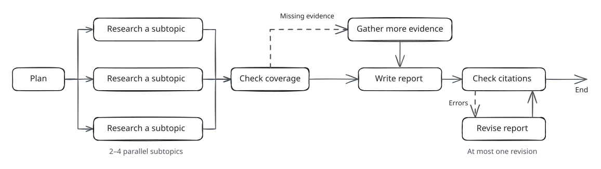

# Part 1: Build and analyze a deep research agent

In this part, you will build a LangGraph research agent, run it on 16
questions, and measure the workload it sends to an inference engine: which
operations determine each report's latency, how much prompt content repeats
and for how long, and how much KV memory concurrency costs. Work through
[`notebooks/part1_deep_research.ipynb`](../notebooks/part1_deep_research.ipynb);
this handout is the specification.

## The agent



| Step | What happens |
|---|---|
| Plan | One LLM call splits the question into two to four subtopics. |
| Research each subtopic, in parallel | One search, up to three fetches, and one LLM call that extracts evidence quotes from the fetched documents. |
| Check coverage | Code finds the first subtopic with no evidence. If there is one, a single follow-up branch researches it again with a broader query. |
| Synthesize | One LLM call writes the report, citing evidence ids. |
| Validate | The supplied checker confirms that each cited quote appears in its source. If the report fails, one repair call fixes it and the checker runs again. |

The tracing client limits each report to 8 LLM calls, 5 searches, and 15
fetches, and each operation to 3 attempts.

### LangGraph in five concepts

See the [LangGraph documentation](https://langchain-ai.github.io/langgraph/) for more.

- **State** is a dict that flows through the graph (`ReportState` in
  `research_app/agent.py`). A node is `async def node(state, config) -> dict`
  and returns only the keys it changes.
- **Edges**: `g.add_edge("synthesize", "validate")` runs `validate` after `synthesize`.
- **Conditional edges**: `g.add_conditional_edges("coverage", route_coverage, ["followup", "synthesize"])`
  calls `route_coverage(state)` and goes to the node it names.
- **Fan-out**: a routing function returns a list of `Send("research_subtopic", payload)`,
  and LangGraph runs `research_subtopic` once per `Send`, in parallel. `branches`
  is declared `Annotated[list[BranchResult], operator.add]`, so each branch
  returns a one-element list and LangGraph concatenates them.
- **Join**: `g.add_edge("research_subtopic", "coverage")` runs `coverage` once,
  after every branch finishes.

### Supporting files

| File | Contents |
|---|---|
| `research_app/tracing.py` | The tracing client. Every LLM and tool call goes through it; it records the trace and enforces the budgets. |
| `research_app/prompts.py` | Prompt builders, laid out so that calls share prefixes: instructions first, then documents, then the part that varies. Every call starts with the same 732-token system prompt, standing in for the long system prompts of production agents. |
| `research_app/corpus.py` | 48 Wikipedia articles on six systems topics at two revisions, behind `search()` and `fetch()`, with a seeded tool-latency model. |
| `research_app/llm.py` | `BedrockLLM` (the Converse API) and `FakeLLM` (deterministic and offline). |
| `research_app/artifacts.py`, `research_app/citations.py` | `Evidence`, `Claim`, `Report`, `BranchResult`, and the citation checker. |
| `research_app/data/questions.json` | The questions; you run the 16 marked `public`. |

## 1.1 Concurrency limiter

All 16 reports share one cap C on concurrent LLM calls, enforced by
`ConcurrencyLimiter` in `research_app/concurrency.py`. Complete its `acquire`,
`release`, and `set_limit` methods as the TODO comments specify. A call keeps
its slot through retries, and tool calls do not take slots. Lowering the limit
lets running calls finish, and raising it must wake waiting calls.

```bash
pytest tests/test_part1_concurrency.py
```

## 1.2 Research graph

Implement the nodes, routing functions, and `build_graph` in
`research_app/agent.py`; the TODO comment at each one specifies its behavior.
Start with `build_graph`. The notebook's single-report cell stops with
`NotImplementedError` at the first node you have not written.

Inside a node, `ctx = ctx_of(config)` gives the tracing client (`ctx.client`),
the report id (`ctx.rid`), and the settings (`ctx.settings`):

```python
resp, op = await ctx.client.llm_call(
    "extract",
    messages,                                   # from prompts.extract_messages
    op_id=f"{ctx.rid}/{subtopic.subtopic_id}/extract",
    deps=fetch_op_ids,                          # every fetch the branch waited for, including failed ones
    order=(1, index, 2),
    max_tokens=ctx.settings.extract_tokens,
)
```

- `deps` are the operations this one waits for. They become the edges of the
  report's DAG in the exported trace.
- `op_id` names the operation's place in the report, and `order` sorts the
  recording. Use the table below; the tests look operations up by `op_id`.
- Every client method returns `(result, op)`. `result` is `None` after a
  permanent error or a third failed attempt; in that case, return a
  `BranchResult` that records the failure instead of raising an exception.
- The `research_branch` TODO specifies branch statuses and timeouts. The
  follow-up branch and synthesis take their `deps` from `_branch_tails`.

In the table, `R03` is the report id and `f2` is a `subtopic_id`. Subtopic ids
start at `f1`, so `f2` has plan index `i = 1`, and the `k`-th fetch, counting
from 0, is `fetch{k+1}`.

| Operation | `op_id` | `order` |
|---|---|---|
| Plan | `R03/plan` | `(0,)` |
| Subtopic search | `R03/f2/search` | `(1, i, 0)` |
| Subtopic fetches, in hit order | `R03/f2/fetch1` … `R03/f2/fetch3` | `(1, i, 1, k)` |
| Subtopic extract | `R03/f2/extract` | `(1, i, 2)` |
| Follow-up branch | `R03/followup/search`, `.../fetch1` …, `.../extract` | `(2, 0, …)`, same steps |
| Synthesize | `R03/synthesize` | `(3,)` |
| Citation check | `R03/validate` | `(4,)` |
| Repair | `R03/repair` | `(5,)` |
| Check after repair | `R03/revalidate` | `(6,)` |

Two mistakes produce valid reports but wrong traces. First, use the stage
names `plan`, `extract`, `synthesize`, and `repair` with the matching
`prompts.*_messages` builder, because `FakeLLM` recognizes calls by stage.
Second, make every operation's `order` sort after its `deps`; otherwise, the
export silently rewires the DAG.

```bash
pytest tests/test_part1_agent.py tests/test_part1_citations.py tests/test_part1_llm.py tests/test_part1_trace_export.py
```

## 1.3 Workload analysis

Implement the four functions in `research_app/analysis.py`. `critical_path`
takes a run loaded with `load_run("runs/c2")`; the other three take
`run.llm_calls()`, the run's completed LLM calls in start order. Each `Op`
records an operation's dependencies, times, slot wait, token counts, and
`block_hashes`.

- `critical_path(run, report)` returns the operations that determined when the
  report finished. Start from its latest-ending operation (ties: larger
  `op_id`) and repeatedly step to the dependency that ended last. Each `Step`
  splits its share of the latency into `gap` (from its blocking dependency's
  end, or the report's arrival, to its start), `wait` (for an LLM slot), and
  `service` (the rest, including retries). The steps add up to the report's
  latency.
- `prefix_hit_rate(calls)` is the fraction of prompt tokens in full 256-token
  blocks whose block hash appeared in an earlier call: the hit rate of an
  unbounded prefix cache. A prompt's final partial block never counts.
- `reuse_intervals(calls)` gives, for each reuse of a block, how long the block
  sat unused: the reusing call's start minus the latest end of the earlier
  calls that held it, or 0 if one of them is still running.
- `kv_footprint(calls)` gives the KV bytes held by the LLM calls holding a slot,
  at every time that changes, both with each call storing its own blocks
  (`private`) and with identical full blocks stored once (`shared`). Use
  128 KiB per token (Llama-3-8B in bf16).

```bash
pytest tests/test_part1_analysis.py
```

## 1.4 Runs and questions

Run the 16 public questions three times, one report starting every 2 seconds:

```bash
python -m research_app.run --cap 2 --replay --out runs/c2
python -m research_app.run --cap 8 --replay --out runs/c8
python -m research_app.run --cap 8 --failure-rate 0.2 --replay --out runs/c8-faults
```

These commands use the offline `FakeLLM`; to use Bedrock, set
`AGENTKV_BEDROCK_MODEL` and add `--backend bedrock`. `--failure-rate 0.2` makes
each tool attempt fail with probability 0.2. Every run must print
`16/16 valid`. Each run writes `trace.jsonl`, `reports.json`, `summary.json`,
and `replay.json` (the run as a trace the simulator can replay). Bedrock does
not expose its KV cache, so `block_hashes` are computed locally over 256-token
blocks and show potential reuse.

The notebook plots your analysis and replays your C = 8 run in the simulator at
caps 1–16 and KV capacities of 12,288–393,216 tokens. Answer Q1–Q4 with numbers
from your runs.

**Q1. Critical path.**

- For one C = 2 report, show its DAG with the critical path, and give the seconds of gap, slot wait, LLM service, and tool service on the path.
- Give the same breakdown averaged over all reports at C = 2 and at C = 8.
- Name the one change to the agent or the cap that would shorten the C = 8 critical path most, and estimate the saving from your breakdown. You do not need to implement it.

**Q2. Prefix reuse.**

- Report `prefix_hit_rate` overall and per stage (as notebook section 5b computes it) at C = 2 and C = 8, and name the content each stage reuses.
- Group `reuse_intervals` by the stage that reuses the block, and give the median and maximum interval for each.
- Which prefixes would you never keep in a cache, and why?

**Q3. Concurrency and memory.**

- Fill in this table:

  | | Mean report latency | Makespan | Mean slot wait | Peak concurrent LLM calls | Peak KV, no sharing | Peak KV, prefix sharing |
  |---|---|---|---|---|---|---|
  | C = 2 | | | | | | |
  | C = 8 | | | | | | |

- For each KV capacity in the replay sweep, give the cap beyond which mean latency stops improving, and explain why it differs between capacities.
- On one 80 GB A100 with 16 GB of Llama-3-8B weights, which cap would you choose for this workload, and how much memory would remain free at its peak?

**Q4. Failures.**

- Compare `runs/c8-faults` with `runs/c8`: count retried operations, follow-up branches, and repairs, and say how many lie on a critical path.
- Give the median and maximum report latency of both runs.
- An LLM call keeps its slot while it backs off between attempts. At C = 2, would releasing the slot during backoff help or hurt mean report latency? Argue from your C = 2 slot waits; no experiment is needed.

## Optional: research on the live web

After the required work, notebook section 6 runs the same agent with live web
search (Exa, Tavily, Perplexity, or OpenAI) instead of the local corpus. It is
not graded.
