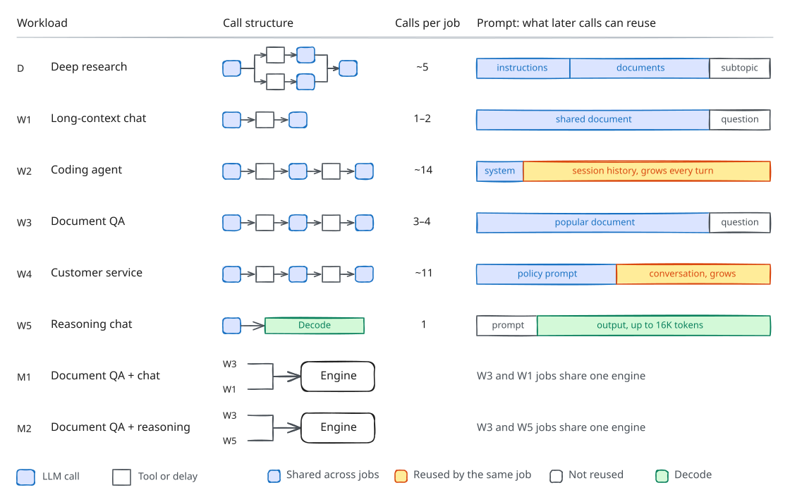
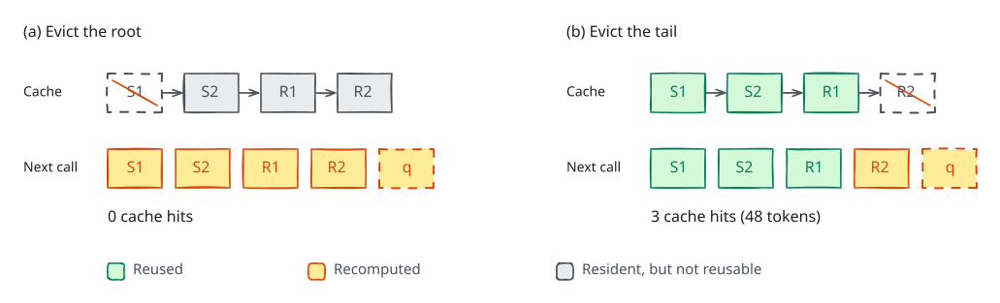

# Part 2: KV-cache eviction and routing

An inference engine can keep a finished call's KV blocks so that a later call
with the same prompt prefix skips prefill. Those cached blocks, however, take
memory that running calls need. In this part, you will implement three
policies for the simulated engine: LRU eviction, which becomes the reference
for Part 3; eviction that keeps prefix trees reusable; and routing that trades
cache hits against load across two GPUs. Work through
[`notebooks/part2_lru_policy.ipynb`](../notebooks/part2_lru_policy.ipynb); this
handout is the specification.

## The simulator

Each trace fixes a workload of 16 jobs. A job is a DAG of LLM calls and tool
delays with fixed prompts, output lengths, and arrival times. The simulator
replays a trace on Llama-3-8B running on one or two A100s, using Vidur's vLLM V1
scheduler (which mixes prefill and decode in a batch) and Vidur's timing
predictions from A100 profiling data. Each GPU, or *replica*, has its own queue
and KV cache. The traces cover eight workload families:



A job's **latency** is the time from its arrival until its last call or tool
finishes. On a trace, a policy's **speedup** is the reference's mean job latency
divided by the policy's; `score()` combines speedups across the eight families
(see the [Part 3 handout](part3_handout.md#scoring)).

As in vLLM's prefix caching, KV memory is a pool of 16-token blocks, and each
full block of a prompt is identified by a `block_hash` of its tokens and every
token before it. A block is in one of three states:

- *active*: a running call holds it (`ref_cnt > 0`);
- *cached*: no call holds it, but its contents stay in memory in case a later prompt starts the same way;
- *empty*.


A new block takes an empty slot if one exists; otherwise, the engine overwrites
a cached block that your policy chooses. Each trace's memory is sized to its
working set, so eviction matters. A cached block is reused only if every block
before it in the prompt is also cached.

## The policy API

A policy is a class in one file. Two hooks are required, and the others default
to the reference behavior.

| Hook | Returns | Default |
|---|---|---|
| `on_event(event, state)` | nothing; observes every event (fields in `agentkv.policy.EVENT_FIELDS`) | ignore |
| `target_concurrency(view, state)` | the most calls in flight across all replicas, 1–16 | required |
| `choose_victim(view, candidates, state)` | one id from `candidates`, the cached blocks on `view.replica`, oldest-released first | required |
| `dispatch_order(view, ready, state)` | ready call ids to dispatch, in order (any subset) | oldest first |
| `route_call(view, call, state)` | the replica for a dispatched call | fewest calls in flight |
| `admission_order(view, waiting, state)` | `waiting` reordered; the engine admits from the front while calls fit | first come, first served |
| `batch_token_budget(view, state)` | 512, 1024, 2048, or 4096 tokens for the next batch on `view.replica` | 2048 |
| `choose_preempted(view, running, state)` | the running call that gives its blocks back when memory runs out | `running[-1]` |

`view` is a read-only snapshot of the engine (`agentkv.policy.View`). It holds
memory and queue counts, in total and per replica; the ready and in-flight
calls, each with its job, stage, prompt length, and `block_hashes`; every
resident block, with its `block_hash`, `parent_hash`, replica, and `ref_cnt`;
and the live jobs. `view.num_cached_blocks(call, r)` counts the leading blocks
of a call's prompt that are resident on replica `r`. `state` is a dict for your
own data, and `state.rng` is the only allowed source of randomness. Ids are
opaque and differ between traces.

Policies run in a sandbox with 50 ms of CPU per hook call and 4 MiB of state;
the [Part 3 handout](part3_handout.md#policy-rules) lists the rules.

```bash
python -m agentkv.score --policy policies/prefix_policy.py --split public_dev --params '{"balance_threshold": 2}'
python -m agentkv.score --policy policies/reference.py --split public_dev --replicas 1 --params '{"cap": 4}'
```

`score()` uses two replicas unless you pass `replicas=1`, and `viz.record` uses
one unless you pass `replicas=2`. `score()` scores traces in parallel on all but
one CPU (at most 12; set `AGENTKV_WORKERS` to change this), so call it from a
notebook or from a script under `if __name__ == "__main__":`.

## 2.1 LRU

Complete `__init__`, `on_event`, and `choose_victim` in `policies/reference.py`.
An `alloc` or `hit` event makes a block the most recently used; a `release`
does not, and an `evict` removes it. `choose_victim` returns the least recently
used block among `candidates`. Because several events can share a timestamp,
track recency in event order rather than by time. `target_concurrency` already
returns the `cap` parameter (default 8).

```bash
pytest tests/test_part2_lru.py tests/test_reference_results.py
```

The second test takes a few minutes and checks that your file reproduces the
staff reference's job latencies exactly on both public splits. Scoring always
compares against the staff copy, so you can score other policies before you
finish this file.

## 2.2 Prefix-aware eviction



A call touches its prompt's blocks from root to tail, so LRU sees the root of a
prefix as the least recently used block, and evicting it strands every block
after it. Complete `__init__`, `on_event`, and `choose_victim` in
`policies/prefix_policy.py` so that `choose_victim` returns the least recently
used candidate that is a *leaf*, or the least recently used candidate if none
is. A candidate is a leaf if no resident block on its replica has a
`parent_hash` equal to the candidate's `block_hash`. With `leaf_first=False`,
the policy is plain LRU.

Build the prefix trees from events. An `alloc` event carries the block's
`block_hash`, `parent_hash` (`None` for a prompt's first block), and `replica`,
so store them; an `evict` event carries only the block id. The tests call
`choose_victim` with `view=None`, so do not read `view.blocks`.

## 2.3 Cache-aware routing

With two replicas, a prefix cached on one replica does not help a call sent to
the other. Following the cache-aware policy of SGLang's router, implement
`route_call` in the same file: among replicas whose `in_flight` is at most
`balance_threshold` above the least loaded replica's, return the one with the
most cached blocks of the call's prompt (`view.num_cached_blocks`), breaking
ties by lower `in_flight` and then lower replica id. With
`balance_threshold = -1`, return the least loaded replica, as the reference
does.

```bash
pytest tests/test_part2_prefix.py
```

With `leaf_first=False` and `balance_threshold=-1`, `PrefixPolicy` makes
exactly the reference's decisions.

## 2.4 Experiments and questions

The notebook sweeps the concurrency cap on one and two replicas, compares FIFO,
LRU, and prefix-aware eviction, sweeps `balance_threshold`, and shows a
customer-service trace at thresholds 1 and 16. Run your own variants as copies
under `candidates/` rather than by editing the two graded files.

**Q1. Concurrency.**

- From the two cap grids, which families prefer a low cap on one replica? Explain using their memory per call, prefix reuse, and job structure.
- Why does the best cap change with two replicas?
- Name one family whose best cap likely changes within a trace, and the trace feature that causes it.

**Q2. Eviction.**

- In one table, give S and the per-family speedups, relative to LRU, of FIFO on one replica and of prefix-aware eviction on one and two replicas.
- Which families gain most, and what about their prompts explains it? Why is the gain smaller on two replicas?
- Describe a workload, real or hypothetical, in which evicting leaves first does worse than LRU.

**Q3. Routing.**

- Include the `balance_threshold` grid and name the best threshold.
- Which families lose at threshold 16, and what in the two W4 timelines shows why?
- How would you change `route_call` so that it never does worse than least-loaded routing on W4?
