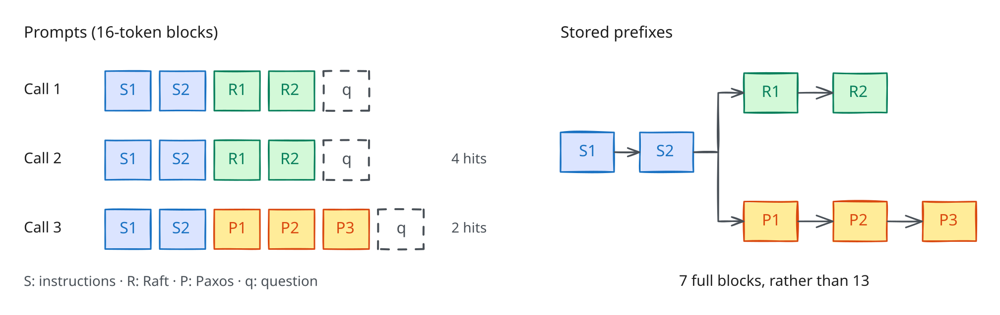

# Part 2: Write an LRU policy

Allow about 1 hour for this part, which is worth 5 points. Work through
[`notebooks/part2_lru_policy.ipynb`](../notebooks/part2_lru_policy.ipynb)
and use this handout for the policy API and implementation requirements.

## Introduction

In this part, you will implement an LRU eviction policy and examine how it
affects the time needed to complete agent jobs. The engine retains released
KV blocks so that later calls with matching prompt prefixes can reuse them,
avoiding repeated prefill work. This is useful for agent workloads, which
often repeat instructions, documents, and conversation history across calls.

Retaining prefixes also consumes memory that other calls may need. A serving
policy therefore controls which cached blocks to evict, how many calls to
run concurrently, and how to order their execution. Each policy in this
assignment is a Python class implementing the API below. Writing LRU with
a fixed concurrency cap will introduce that API before your research agents
use it in Part 3. Your completed implementation is also the starting reference
policy for Part 3. The notebook compares it with FIFO and explores changes to
its settings.

## Background: prefix caching



Memory is a pool of 16-token blocks. Each block is in one of three states:

- **active**: some call in flight holds it (its reference count is above zero);
- **cached**: no call holds it, but its contents are kept in case a later prompt
  starts the same way;
- **empty**: holding nothing reusable.

A new block takes an empty slot if there is one. When there is none, the
engine overwrites a cached block, and your policy's `choose_victim` picks
which. Active blocks are never candidates.

Each trace gives the engine far less KV memory than a dedicated GPU would: 736
to 6,656 blocks in the public traces, sized to that trace's working set so that
eviction decisions matter.

## The policy API

A policy controls concurrency, scheduling, and eviction through eight hooks.
Two are required, and the others have defaults. If an optional hook is
omitted, the engine uses first-come, first-served dispatch and Vidur's
vLLM V1 scheduling rules. The workload and hardware configuration remain fixed.

```python
from agentkv.policy import Policy

class MyPolicy(Policy):
    def on_event(self, event, state): ...                              # optional
    def target_concurrency(self, view, state) -> int: ...              # required
    def choose_victim(self, view, candidates, state) -> str: ...       # required
    def dispatch_order(self, view, ready, state) -> list[str]: ...     # optional
    def admission_order(self, view, waiting, state) -> list[str]: ...  # optional
    def route_call(self, view, call, state) -> int: ...                # optional
    def batch_token_budget(self, view, state) -> int: ...              # optional
    def choose_preempted(self, view, running, state) -> str: ...       # optional
```


Prefill, decode, and preemption have the same meanings as in Assignment 3.
Vidur can combine prefill and decode tokens in one batch. The default batch
budget is 2,048 tokens; policies can choose 512, 1,024, 2,048, or 4,096. The
API also uses the following terms:

- **dispatch**: the application (the replay driver that runs the jobs) sends
  a ready call, one whose dependencies have finished, to the engine, where it
  waits to be admitted;
- **admission**: the engine takes a waiting call, allocates its blocks, and
  starts its prefill;
- **job latency**: a job's time from arrival until its last step (LLM call or
  tool) finishes. Every score in this assignment is about mean job latency.

| Hook or input | Contract |
|---|---|
| `on_event` | Receives every event, in logical-time order with a fixed tie-breaker: `arrival`, `ready`, `dispatch`, `admit`, `hit`, `alloc`, `release`, `evict`, `preempt`, `complete` (with the call's queueing time and latency), `tool_start`, `tool_done`, and `job_done`. Their fields are in `agentkv.policy.EVENT_FIELDS`. |
| `target_concurrency` | The most calls in flight (dispatched and not complete), an int from 1 to 16 across all replicas. Lowering it never cancels calls in flight. |
| `choose_victim` | One id from `candidates`: the cached blocks on `view.replica`, oldest-released first. The engine uses empty blocks first; this hook only picks which cached block to overwrite. |
| `dispatch_order` | Ready call ids in priority order: any subset of `ready`, which is passed oldest first. The application dispatches from the front of your list until the cap is reached; the rest, and any you leave out, stay ready. Default: all of them, oldest first. |
| `admission_order` | `waiting` (dispatched calls the engine has not admitted) reordered. The engine admits from the front while calls fit in memory. Default: first come, first served. |
| `route_call` | Choose an available replica id for a ready call. Default: the replica with the fewest unfinished calls. Part 2 has replica 0; Part 3 has replicas 0 and 1. |
| `batch_token_budget` | Choose 512, 1024, 2048, or 4096 tokens for the next batch on `view.replica`. Default: 2048. |
| `choose_preempted` | When a decoding call needs a new block and every block is active, which of `running` gives its blocks back and is recomputed later. Default: the last one, `running[-1]`. |
| `view` | A read-only snapshot of the engine (below). All ids are opaque and rekeyed every run. |
| `state` | A dict for data your policy retains between events, plus `state.rng`, the only allowed source of randomness. `state` and the policy's own attributes must pickle to at most 1 MiB. Both are reset for each trace. |

What `view` holds (the fields are in `agentkv.policy.View`):

- memory counts: `total_blocks`, `empty_blocks`, `active_blocks`, `cached_blocks`, and `pressure` (the fraction of blocks that are not empty);
- queue counts: `waiting` counts calls not currently admitted, including preempted calls; `running` includes calls decoding or partway through prefill;
- `replicas`: per-replica queue and memory counts; `replica` identifies the target of an engine decision;
- `ready` and `calls`: each call's job, stage, known input length, prompt prefix identities, and assigned replica;
- `blocks`: physical residence ids, content identities (`prefix`), preceding content identities (`parent`), `depth`, `refs`, `hits`, `replica`, and last access. Multiple physical blocks can hold the same prefix;
- `jobs`: the jobs that have arrived and not finished.

The small `BlockHarness` examples teach the eviction contract. They do not
simulate GPU timing. Trace experiments use Vidur; see the
[configuration and limitations](../README.md#evaluator-configuration).

## Task: LRU (5 points)

Complete `policies/reference.py`: LRU eviction among cached blocks, with a fixed
concurrency limit. `target_concurrency` already returns the `cap` parameter
(default 8); initialize the tracking state, then implement `on_event` and
`choose_victim`. The starter contains TODOs, not a completed reference.

- A block becomes recent when it is allocated (an `alloc` event) or reused (a
  `hit`). A `release` alone does not make it recent.
- Forget a block when you see its `evict` event.
- Follow event delivery order when accesses have the same timestamp. Reading
  block timestamps alone does not implement this ordering.
- `choose_victim` returns the least recently used id among `candidates`.

Local scoring compares candidates with saved results from the staff reference,
so it works before you finish this file. Once your implementation passes the
tests, its default configuration should reproduce the reference score of
1.0000. Changes to your local file cannot change the saved comparison results.

Check it with:

```bash
pytest tests/test_part2_lru.py tests/test_kv_invariants.py
```

The public oracle uses one-token blocks and a memory of three blocks.
`agentkv.harness.BlockHarness` drives a policy through exactly these steps;
use it to try your own scenarios.

| Step | Expected result |
|---|---|
| Allocate A and B, then release both | A and B are cached, A older than B. One slot is still empty. |
| Allocate C, then release C | C takes the empty slot. Nothing is evicted. |
| Access A, then release A | An exact-prefix hit. Recency from oldest to newest is B, C, A. |
| Allocate D under pressure | LRU evicts B. A and C stay cached, and B's old lookup entry is removed. |
| Hold A active, then allocate E | A and D are active, so C is the only cached block, and it is evicted. |

## What the engine guarantees

The supplied engine enforces the following invariants, which are checked by
the public tests:

- A block with a nonzero reference count is never a victim, and counts never go negative.
- A cached block keeps its contents and identity until it is overwritten. An
  exact-prefix match makes it active again.
- Overwriting a block first removes its old lookup entry, so a stale mapping
  cannot cause a false hit.
- The same tokens under a different parent form a different prefix. Partial
  blocks are never shared.
- If every block is active, the engine waits, or preempts the call
  `choose_preempted` names. A policy cannot create an evictable block.

Reference counting, hashing, allocation, kernels, retries, and trace parsing
are provided and must remain unchanged.

## Experiments

Part 2 is graded on correctness. The remaining notebook sections examine
performance to prepare you for Part 3. Their scores do not affect your Part 2
grade. Evaluate the one-replica configuration with:

```bash
python -m agentkv.score --policy policies/reference.py --split public_dev --replicas 1 --params '{"cap": 4}'
```

The notebook then:

1. compares concurrency caps on document QA and deep research traces;
2. sweeps the cap over all eight families;
3. compares FIFO with the completed reference and varies batch token budgets;
4. compares FIFO with basic LRU and examines how prefix structure affects eviction;
5. adds a dispatch-order hook and measures its effect on mean job latency.

## Hints and common pitfalls

- An `OrderedDict` with `move_to_end` gives you O(1) recency updates.
- Your recency order also contains active blocks, which are never in
  `candidates`. Return the least recent block that *is* a candidate.
- A block can be released and hit again many times. Only `alloc` and `hit`
  change its recency.
- Keep `policies/reference.py` exactly what the tests specify. Put experiments in
  copies under `candidates/`, as the notebook does.

## Grading (5 points)

All 5 points are based on LRU correctness. Use the public oracle and invariant
tests in `tests/test_part2_lru.py` and `tests/test_kv_invariants.py` during
development. Staff tests check the same contract on hidden access sequences,
including repeated hits, releases, and allocations after eviction. Include
`policies/reference.py` with the Part 1 implementation files in the team's Canvas
archive, preserving the directory paths. Gradescope is used only for the
Part 3 policy leaderboard.
